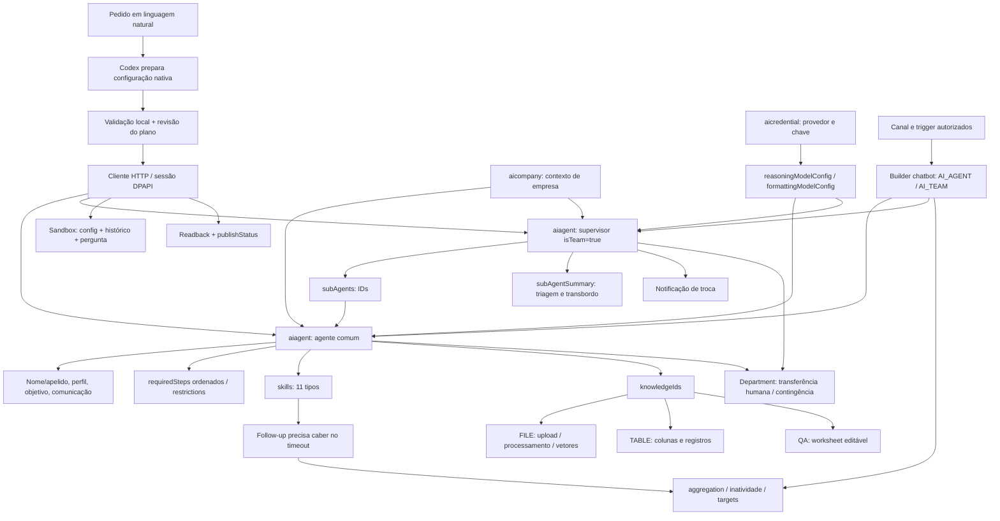

# Esquema recuperado do módulo Agentes Inteligentes

Este é o mapa de recursos/configuração do cliente publicado; backend privado e todas as jornadas não foram executados. Em [contracts.md](contracts.md), [skills.md](skills.md) e [knowledge.md](knowledge.md), cada caixa ganha payload, endpoint e limites.

## Agente comum, por abas

| Área | Conteúdo persistido |
|---|---|
| Perfil | name, agentName/nickName/assinatura, communicationForm, responseLength, profile, goal, aiCompanyId |
| Etapas | requiredSteps [{order,step}], restrictions |
| Habilidades | skills[] com descrição de acionamento, active, supressMessage e config específica |
| Conhecimento | knowledgeIds[] com bases FILE/TABLE/QA independentes |
| Configuração | version, credentialId/modelos/esforço, temperature, maxTokens, formato adicional, messageInterval, transferência/contingência |
| Teste | sandbox com DTO do formulário, histórico e nova pergunta |

Supervisor conserva perfil/configuração e acrescenta distribuição: subAgents, resumos curtos/longos, aviso de troca e habilidades de fluxo. Não há “etapa” como recurso remoto distinto no código recuperado: etapas são instruções ordenadas no promptConfig.

## O que existe além das abas

- Empresas e credenciais têm CRUD próprio e podem ser compartilhadas entre agentes.
- Bases têm metadata, conteúdo, processamento e visibilidade; a associação no agente não contém o arquivo/tabela em si.
- Privacidade/permissões e dependências de arquivamento afetam edição/lifecycle.
- Otimizador produz sugestões; não substitui configuração autorizada/testes.
- Logs de ferramentas/conhecimento usam serviço aitoollog; a UI possui inspeção de parâmetros/resultados.
- Canal/chatbot define entrada da conversa; o agente provisionado sozinho não comprova ativação de atendimento.

## Cobertura efetivamente alcançada

Pesquisa pública e leitura de todo o módulo principal IA: recursos, formulários, catálogos, serialização, validadores locais, serviços/endpoints e consumidores conhecidos. REA parsed15 módulos selecionados sem executar fornecedor; parte do grafo semântico sofreu limite de memória. Leitura real confirmou5 superfícies HTTP. Scripts locais foram testados com mocks e revisados.

Não executados: escritas em conta, upload/indexação, sandbox/optimizer, habilidade efetiva, publicação de chatbot/canal, follow-up real, multimídia e conversas com supervisor. Backend/infra privada e alcance dinâmico não podem ser chamados completos a partir de frontend. Consulte evidence.md antes de usar “comprovado”.
